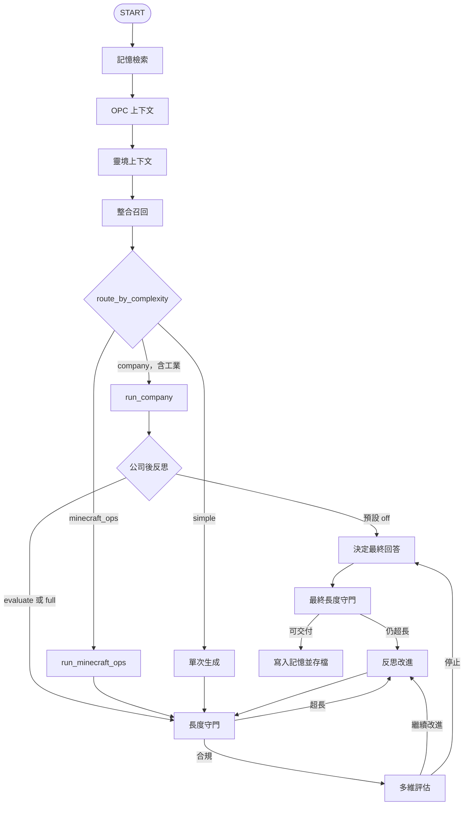

<div align="center">

# 靈境·Linkin

**靈境·Linkin 運行時 — 具反思閉環的統一 AI 管線、多代理人指揮鏈與監控控制台**

反思閉環、RAHO 公司運行時、OPC 工業整合與 Minecraft 輕量操作共用同一條前置鏈。`resolve_execution_path` 依策略與內容選路，LangGraph、SSE 與任務 API 用同一份判斷。

[](https://github.com/iiooiioo888/Linkin/actions/workflows/test.yml)
[](LICENSE)
[](https://www.python.org/)
[](https://nodejs.org/)
[](https://fastapi.tiangolo.com/)
[](https://github.com/langchain-ai/langgraph)
[](https://react.dev/)

**倉庫：** [靈境·Linkin](https://github.com/iiooiioo888/Linkin)（MIT）  
**靜態預覽：** [iiooiioo888.github.io/Linkin](https://iiooiioo888.github.io/Linkin/)（只預覽 UI；對話與寫入需本機或 Docker 後端）  
**上游：** [靈境·Linkin 原始碼](https://github.com/iiooiioo888/Evoloop)

單一主線 · 僅 `master` · 文件對齊：2026-10-22

</div>

---

## 目錄

- [先讀哪一份](#先讀哪一份)
- [核心能力](#核心能力)
- [運作邏輯](#運作邏輯)
- [目錄結構](#目錄結構)
- [快速開始](#快速開始)
- [部署](#部署)
- [Agent skills](#agent-skills)
- [文件索引](#文件索引)
- [關鍵約束](#關鍵約束)
- [技術棧](#技術棧)

---

## 先讀哪一份

| 你要做的事 | 打開 |
|------------|------|
| 第一次打開倉庫 | [新人導覽](docs/onboarding.md) → [目錄地圖](docs/structure.md) → [角色介紹](docs/company/roles.md) → [快速開始](#快速開始) |
| 改後端或前端 | [開發指南](docs/development/guide.md) · [貢獻指南](CONTRIBUTING.md) |
| 查 API 或環境變數 | [REST API](docs/api/reference.md) · [配置參考](docs/config/reference.md) |
| 對術語或埠號 | [術語表](docs/glossary.md) |
| 給 Agent 或自動化看邊界 | [AGENTS.md](AGENTS.md) |
| 卡住了 | [常見問題](docs/faq.md) |

知識庫總索引：[docs/README.md](docs/README.md)

---

## 核心能力

| 能力 | 做什麼 |
|------|--------|
| **統一管線** | 每則查詢先注入記憶、感測上下文、靈境上下文與整合召回，再由 `resolve_execution_path` 在 `simple`、`company`、`minecraft_ops` 中選一條 |
| **反思閉環** | 簡單路徑做多維評分與改進迴圈。指揮鏈預設定稿；Minecraft 輕量路徑評估一次 |
| **指揮鏈** | 公司運行時與 OPC 是同一條：L5 用戶 → L4 審計 → L3 戰術 → L2 執行；L1 憲兵；L0 記憶與感測。工業查詢用 `industrial_ops`，步驟是感知 → 預處理 → 分析 → 診斷 → 決策 → 執行。**85** 席 |
| **Grill-Me** | 對話裡的指揮鏈先經 `/raho/grill/*` 鎖需求，再建立任務 |
| **監控控制台** | 對話、控制台、靈境、Minecraft、實驗室。Linear 風 dense UI，桌面三欄約一屏高 |
| **行動版** | 768px 以下改底部 Tab 與 safe-area；桌面 ≥1440 維持三欄 |
| **整合召回** | MemOS、OpenViking、WeKnora、Yao、Ouroboros、OpenPencil。只在明確召回時省 token，不接受自動 webhook |
| **積分與計費 v6** | 虛擬積分錢包（不是第三方支付）。個人／共享／貢獻／故障多池，Docker 按時計費，方案牌價，阿里雲成本唯讀對帳 |
| **AI Hub** | 探針、熔斷、目錄；多 API 路由與模型池鎖定 |
| **OPC** | 指揮鏈的工業執行與 OPC UA 微服務。寫入必經護欄 |
| **Minecraft MCP** | MineMCP JSON-RPC 與靈境鐵律。角色只經 tool_registry |

---

## 運作邏輯

實作在 `backend/core/execution_path.py` 的 `resolve_execution_path`。圖上的條件邊 `route_by_complexity` 只負責把這份結果對到節點。

### 選路

`execution_strategy` 為 `simple` 或 `company` 時直接採用，後面的規則不再改路。`auto` 依序看：

| 順序 | 條件 | 路徑 |
|------|------|------|
| 1 | 工業關鍵詞（感測、閥門、OPC、PLC…） | `company`，模板 `industrial_ops` |
| 2 | 靈境複雜任務 | `company` |
| 3 | Minecraft 建造、敘事、多步 | `company` |
| 4 | Minecraft 單步控制 | `minecraft_ops` |
| 5 | 已開啟 cost_speed | 依複雜度設定為 `company` 或 `simple` |
| 6 | 公司關鍵詞，或長度達到門檻 | `company`，否則 `simple` |

### 圖上怎麼走

每條進圖的查詢都先走完前置鏈，再分叉。工業查詢進 `run_company`，執行的是同一條指揮鏈的感知到執行。



公司運行時失敗且沒有足夠產出時，直接存檔結束。有部分產出則改走評估。

### 三條路的收尾

| 路徑 | 生成之後 |
|------|----------|
| `simple` | 長度守門後做多維評估。未達標、迭代未用盡、且分數仍有提升時，反思並改進 |
| `minecraft_ops` | 輕量 ReAct 加 MineMCP。評估一次後定稿；只有超長才回到反思 |
| `company` | 指揮鏈。一般任務走席位分工。工業任務（`industrial_ops`）走感知 → 預處理 → 分析 → 診斷 → 決策 → 執行，寫入經護欄。`EVOL_POST_COMPANY_REFLECT` 預設 `off`。超長仍回到反思 |

Grill-Me 在圖的外面。對話送出指揮鏈時，前端先叫 `/raho/grill/*`，鎖住簡報後才 `POST /tasks`。

### 請求從哪裡進來

| 入口 | 實際分派 |
|------|----------|
| 對話 `#/chat` | 先取路由預覽。指揮鏈先 Grill，再 `POST /tasks` 與 WebSocket。`simple` 與 `minecraft_ops` 走 SSE。預覽逾時 1.5 秒則改走 SSE |
| 公司頁 | 直接 `POST /tasks`，策略固定 `company`，然後打開任務 |
| `POST /chat/stream` | 指揮鏈走公司 SSE（工業模板跑感知到執行）；`minecraft_ops` 走編譯圖；其餘走簡單串流 |
| `POST /tasks` | 指揮鏈：`industrial_ops` 跑感知到執行，其他模板跑席位分工。其餘走對應的手抄前置與收尾 |
| `POST /chat` | `evoloop_graph.ainvoke`。工業查詢在 `run_company` 裡跑同一條鏈 |

### 分層

| 層 | 路徑 | 職責 |
|----|------|------|
| 圖與 LLM | `backend/core/` | LangGraph、`resolve_execution_path`、LiteLLM、評估 |
| 指揮鏈 | `backend/company/` | RAHO、85 席、工作項 DAG、預算；工業步驟在 `backend/core/industrial_chain.py` |
| 靈境 | `backend/linkin/` | 憲法、16 席、Minecraft 護欄與輕量 ops |
| 整合 | `backend/integrations/` | 六個整合客戶端與 `/integrations` |
| 計費 | `backend/billing/` | 積分池 v6、Docker 計量、共享池路由 |
| 前端 | `frontend/` | React 19 控制台。視覺 Token 見 [DESIGN.md](DESIGN.md) |
| OPC 微服務 | `opc_service/` | OPC UA。指揮鏈的工業步驟呼叫這裡，寫入經 `guard.py` |

詳圖：[docs/architecture/overview.md](docs/architecture/overview.md) · 六級細節：[docs/architecture/opc-six-stage.md](docs/architecture/opc-six-stage.md)

---

## 目錄結構

套件職責的單一來源是 [docs/structure.md](docs/structure.md)。邊界與禁止事項在 [AGENTS.md](AGENTS.md)。

```
Linkin/
├── backend/                 # FastAPI + LangGraph（backend/README.md）
│   ├── core/ · company/ · linkin/ · billing/ · integrations/
│   ├── hub/ · tools/ · memory/ · services/
│   └── tests/
├── opc_service/             # OPC UA 微服務（opc_service/README.md）
├── frontend/                # React 19 + Vite，預設 :3001
├── .agents/skills/          # Agent skills（見下節）
├── vendor/archify/          # 策略圖 CLI
├── docs/                    # 知識庫（詳文只放這裡）
├── AGENTS.md · CONTRIBUTING.md · DESIGN.md · DEPLOYMENT.md
├── skills-lock.json         # skills 版本鎖
└── docker-compose.yml
```

角色數字：公司 **85** 席，靈境子角色 **16** 席。對照表在 [角色介紹](docs/company/roles.md)。

---

## 快速開始

### 需要的工具

| 工具 | 版本 |
|------|------|
| Python | **3.12+**（見 `pyproject.toml`） |
| Node.js | **20+** |
| Docker | 可選。用來起 Redis、Chroma 或整棧 |

### 埠號

| 情境 | 前端 | 後端 | OPC | Redis | Chroma | MineMCP |
|------|------|------|-----|-------|--------|---------|
| 本機 Vite | **3001** | 8000 | 8001 | 6379 | 8100 | 3000 |
| Compose | **3001** | 8000 | 8001 | 6379 | 8100 | — |

MineMCP 預設 3000，與前端錯開。

### 本機跑起來

```bash
git clone https://github.com/iiooiioo888/Linkin.git
cd Linkin

python3 -m venv .venv
source .venv/bin/activate   # Windows: .venv\Scripts\Activate.ps1
pip install -r requirements.txt

cp .env.example .env
# 填入 API 金鑰。單一廠商請一併設定 api_base 與模型

python backend/scripts/test_llm_connection.py   # 可選
pytest backend/tests/ -q

# 後端 http://localhost:8000
python -m backend.main

# 前端 http://localhost:3001
cd frontend && npm install && npm run dev

# 示範資料，不呼叫 LLM
python -m backend.scripts.seed_demo_content
```

---

## 部署

| 方式 | 指令或結果 |
|------|------------|
| 全棧 | `docker compose up -d` |
| 只起 Redis 與 Chroma | `docker compose up -d redis chroma` |
| GitHub Pages | 靜態前端。對話與寫入仍要後端 |

| 文件 | 裡面有什麼 |
|------|------------|
| [DEPLOYMENT.md](DEPLOYMENT.md) | 部署捷徑，指向完整指南 |
| [docs/deployment/guide.md](docs/deployment/guide.md) | Docker、生產環境、健康檢查 |
| [.env.example](.env.example) | 環境變數範本。不要提交真實金鑰 |
| [docs/config/reference.md](docs/config/reference.md) | 模型池、RAHO、整合開關 |

---

## Agent skills

技能檔的唯一提交位置是 `.agents/skills/`，版本鎖是 `skills-lock.json`。`npx skills add --all` 複製到各 Agent 目錄的副本已在 `.gitignore`，不要提交。

| 來源 | 數量 | 內容 | 說明 |
|------|------|------|------|
| [mattpocock/skills](https://github.com/mattpocock/skills) | 37 | 工程化工作流（TDD、grill、spec→tickets） | skills-only |
| [anthropics/skills](https://github.com/anthropics/skills) | 20 | 文件、前端設計、`mcp-builder` | [作者頁](https://mcpservers.org/zh-TW/agent-skills/author/anthropic) |
| [openai/skills](https://github.com/openai/skills) | 43 | Codex 技能（Figma、部署、安全、Playwright） | [作者頁](https://mcpservers.org/zh-TW/agent-skills/author/openai) |
| [scrapegraphai/just-scrape](https://github.com/scrapegraphai/just-scrape) | 1 | `just-scrape` CLI，需 `SGAI_API_KEY` | [作者頁](https://mcpservers.org/zh-TW/agent-skills/author/scrapegraphai) |
| [vercel-labs/agent-browser](https://github.com/vercel-labs/agent-browser) | 1 | `agent-browser` 瀏覽器自動化 CLI | [技能頁](https://mcpservers.org/zh-TW/agent-skills/vercel/agent-browser) |

上表 **102** 項。Anthropic 與 OpenAI 都有 `pdf`、`skill-creator`，本倉庫分別名為 `anthropic-pdf` / `openai-pdf` 與 `anthropic-skill-creator` / `openai-skill-creator`。

另外內嵌、不計入上表的兩項：`mediacrawler`（多平台採集）、`token-dashboard`（Token 用量看板）。目錄合計 **104**。設定與入口見 [docs/mcp/agent-skills.md](docs/mcp/agent-skills.md)。

### 安裝

```bash
# 還原鎖定版本（建議）
npx skills@latest experimental_install

# 或從上游重裝上表五個來源
npx skills@latest add mattpocock/skills --all --copy
npx skills@latest add anthropics/skills --all --copy
npx skills@latest add openai/skills --all --copy
npx skills@latest add scrapegraphai/just-scrape --all --copy
npx skills@latest add vercel-labs/agent-browser --all --copy
# 裝完刪掉各 Agent 目錄下的副本，只留 .agents/skills/
```

每個 clone 接著在 Agent 裡跑一次 `setup-matt-pocock-skills`，設定 issue tracker、分類標籤與 domain 文件版面。步驟在 `.agents/skills/setup-matt-pocock-skills/SKILL.md`。

多數技能只靠 `SKILL.md`。Figma、Linear、OpenAI Developer Docs 可再接 MCP。`just-scrape` 與 `agent-browser` 是 CLI。片段與環境變數見 [docs/mcp/agent-skills.md](docs/mcp/agent-skills.md)。

### 靈境·Linkin 運行時怎麼用這些檔

| 位置 | 用途 |
|------|------|
| `.agents/skills/` | Cursor 與 `npx skills` 的 canonical 檔（已內嵌） |
| `backend/data/skills.json` | 運行時技能庫。API 與角色提示詞注入讀這裡 |
| `backend/data/mcp_servers.json` | MCP 連線註冊表 |

後端啟動時把 `.agents/skills/` 同步進 `skills.json`。設 `LINKIN_SYNC_AGENT_SKILLS=false` 可關掉。手動同步：

```bash
python -m backend.scripts.sync_agent_skills
```

畫面上：**控制台 → 監控 → 技能與 MCP**（`/#/monitor/skills`）→「同步 Agent 包」。新匯入的技能預設停用，在列表裡啟用後才注入提示詞。類型是 `Agent 包`、`CLI 參考`、`Cursor 專用`。

歸功與授權：[mattpocock/skills](https://github.com/mattpocock/skills) · [anthropics/skills](https://github.com/anthropics/skills) · [openai/skills](https://github.com/openai/skills) · [scrapegraphai/just-scrape](https://github.com/scrapegraphai/just-scrape) · [vercel-labs/agent-browser](https://github.com/vercel-labs/agent-browser) · [NanmiCoder/MediaCrawler](https://github.com/NanmiCoder/MediaCrawler) · [fuyi-git/token-dashboard](https://github.com/fuyi-git/token-dashboard)

---

## 文件索引

| 文件 | 內容 |
|------|------|
| [DESIGN.md](DESIGN.md) | 前端視覺 Token。不是系統架構 |
| [DEPLOYMENT.md](DEPLOYMENT.md) | 部署捷徑 → [完整指南](docs/deployment/guide.md) |
| [CONTRIBUTING.md](CONTRIBUTING.md) | 分支、測試、PR 檢查 |
| [新人導覽](docs/onboarding.md) | 閱讀順序、第一個 PR |
| [目錄地圖](docs/structure.md) | 套件與路徑 |
| [架構總覽](docs/architecture/overview.md) | 統一管線與資料流 |
| [公司運行時](docs/architecture/company-runtime.md) | RAHO、角色、預算 |
| [角色介紹](docs/company/roles.md) | 85 席與 16 席靈境子角色 |
| [AI Hub 設計](docs/AI_HUB_DETAILED_DESIGN.md) | Hub 契約 |
| [靈境世界觀](docs/linkin/worldview.md) | 世界觀 |
| [Minecraft MCP](docs/linkin/minecraft-mcp.md) | 遊戲橋接 |
| [REST API](docs/api/reference.md) | 端點與 SSE |
| [前端](frontend/README.md) | Vite 開發入口 |
| [知識庫](docs/README.md) | 文件總索引 |

---

## 關鍵約束

1. LLM 只經 `backend.core.llm.call_llm`（LiteLLM）。不要直連供應商 SDK。
2. 測試用 `monkeypatch` 隔離外部依賴，不需要真實 API 金鑰。
3. 不要改編譯後的 LangGraph 圖。改 `build_graph()` 與節點。
4. OPC 寫入必須經 `opc_service/guard.py`。
5. Minecraft 寫入必須經 `backend/tools/minecraft_mcp.py` 與 `backend/linkin/minecraft.py`。

完整條文：[AGENTS.md](AGENTS.md) · [CONTRIBUTING.md](CONTRIBUTING.md)

---

## 技術棧

| 層 | 技術 |
|----|------|
| 閉環 | LangGraph + LiteLLM |
| 後端 | FastAPI + asyncio |
| 記憶 | ChromaDB、Redis |
| 工業 | OPC UA（asyncua） |
| 前端 | React 19、Vite、TypeScript、i18next、Linear dense console |
| 測試 | pytest（`backend/tests/`）。CI：[`.github/workflows/test.yml`](.github/workflows/test.yml) |
| 部署 | Docker Compose、GitHub Pages |

---

<div align="center">

[知識庫](docs/README.md) · [新人導覽](docs/onboarding.md) · [API](docs/api/reference.md) · [靜態預覽](https://iiooiioo888.github.io/Linkin/)

</div>
