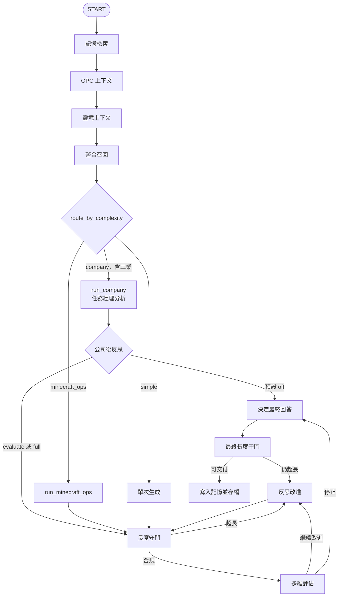

# 架構總覽

> 對齊日期：2026-10-22 · 倉庫產品名：**靈境·Linkin**（EvoLoop 運行時）

> **全景文檔**：部署、分層、LangGraph、公司運行時、計費 v6、對話與前端殼的完整圖解見 **[系統架構與運作流程（全面·2026-09）](system-architecture-2026-09.md)**。組件分類見 [目錄地圖](../structure.md#組件分類)。

Linkin／EvoLoop 是一個**統一模式** AI 系統，所有任務進入同一條管線，由系統自動判斷執行策略。

## 核心理念

```
生成 → 評估 → 反思 → 優化 → 永不停止進化
```

簡單路徑會評估並迭代，直到品質達標。公司路徑預設定稿；要繼續打磨時把 `EVOL_POST_COMPANY_REFLECT` 設成 `evaluate` 或 `full`。

## 三條路徑

| 層級 | 觸發條件 | 流程 |
|------|----------|------|
| **反思閉環** | `simple`；以及公司後反思設為 `full` 時 | 生成 → 評估(0-10) → 反思 → 改進 → 直到達標、迭代用盡或提升過小 |
| **公司（含工業）** | 策略 `company`，或 auto 判為工業、靈境複雜、Minecraft 重型、關鍵詞與長度 | 任務經理分析後席位分工。工業模板 `industrial_ops` 帶工業席位，感測讀數注入目標，寫入經護欄。成功後預設定稿 |
| **Minecraft 輕量** | 單步控制查詢 | ReAct + MineMCP，評估一次後定稿 |

選路優先序與入口分派見根目錄 [README 運作邏輯](../../README.md#運作邏輯)。實作：`backend/core/execution_path.py`。

## 統一管線流程



## 技術棧

| 層級 | 技術 | 用途 |
|------|------|------|
| 核心閉環 | LangGraph + LiteLLM | 反思迴圈圖 + 多模型路由 |
| 後端 | FastAPI + uvicorn | REST API 服務 |
| 公司運行時 | 自研 (company/) | 多代理人協調 · 預算管控 |
| 向量資料庫 | ChromaDB | 記憶存儲與相似檢索 |
| 快取 | Redis | 任務持久化 · 會話狀態 |
| 工業協議 | OPC UA (asyncua) | 工業數據讀寫與訂閱 |
| 靈境世界觀 | `backend/linkin/` | 憲法、工具鐵律、RAG 四庫；**16** 席靈境子角色（另：公司 `STANDARD_ROLES` **82** 席） |
| 前端 | React 19 + Vite + TypeScript | IDE 風格 UI · Tailwind CSS v4 |
| 測試 | pytest + pytest-asyncio | Mock 隔離 LLM／Chroma／OPC |
| 部署 | Docker Compose | Backend、Frontend、Redis、Chroma、OPC、Nginx |

## 數據流

```
使用者 → FastAPI
           ├─ 對話：公司（含工業）→ 任務 API + WebSocket，任務經理分析
           │         simple／minecraft_ops → SSE
           ├─ POST /tasks：任務經理分析後席位分工
           └─ POST /chat 與圖：記憶 → 感測上下文 → 靈境 → 召回
                              → run_company | run_minecraft_ops | 單次生成
                              → 依路徑定稿或反思
                              → 記憶與存檔
```

## 目錄結構

完整套件表與維護規則見 **[目錄地圖](../structure.md)**。精簡樹：

```
Linkin/
├── backend/                     # FastAPI + LangGraph（見 backend/README.md）
│   ├── main.py                  #   REST / SSE / WebSocket 入口
│   ├── auth/ · middleware/ · environment/ · prompts/
│   ├── core/                    #   圖、節點、LLM、評估、模型池
│   │   ├── graph.py             #     build_graph()、複雜度路由
│   │   ├── nodes.py / company_nodes.py
│   │   ├── llm.py               #     call_llm（唯一 LLM 出口）
│   │   ├── provider_pool.py     #     模型池鎖定
│   │   └── evaluation.py        #     多維評估
│   ├── company/                 #   多代理人 + 任務經理 + 量化（82 席）
│   ├── linkin/                  #   靈境／Minecraft 護欄（16 席子角色）
│   ├── modules/                 #   可插拔世界模組目錄與閘道（GET /modules、/{id}/api/*）
│   ├── tools/ · hub/ · memory/ · services/
│   ├── config/                  #   執行期 JSON（價卡等）
│   ├── data/ · scripts/
│   └── tests/                   #   pytest（2026-09-29 對帳 1128 passed；本機預設暫存鎖住時需另指定 --basetemp）
├── opc_service/                 # OPC UA + guard（見 opc_service/README.md）
├── frontend/                    # React 19 + Vite（預設 :3001）
├── vendor/archify/              # 策略圖 CLI
├── docs/                        # 知識庫（詳文唯一來源）
└── docker-compose.yml
```

新人導覽：[docs/onboarding.md](../onboarding.md) · 知識庫索引：[docs/README.md](../README.md) · 目錄地圖：[structure.md](../structure.md)
